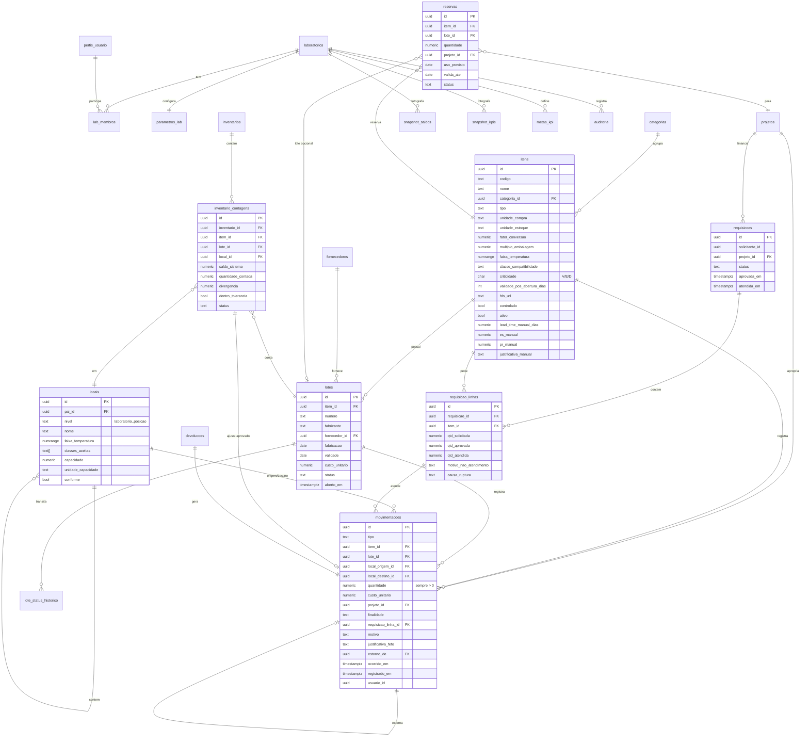

# 2. Modelo de dados

Todas as tabelas de negócio têm `id uuid`, `lab_id uuid` (isolamento por RLS), `criado_em`, `criado_por`. O SQL completo da Fase 1 está em [`supabase/migrations/`](../supabase/migrations/).

## Sinal das quantidades no livro-razão

`quantidade` é sempre positiva; o efeito vem do tipo e dos locais:

| Tipo | Origem | Destino | Efeito no saldo |
|---|---|---|---|
| ENTRADA | — | local | + destino |
| DISPENSACAO | local | — | − origem |
| DEVOLUCAO | — | local | + destino (lote → BLOQUEADO) |
| TRANSFERENCIA | local A | local B | − A, + B |
| PERDA | local | — | − origem |
| AJUSTE_INVENTARIO | local (sobra: destino) | | ± conforme divergência |
| ESTORNO | inverte origem e destino da movimentação estornada | | anula a original |

## Views centrais (definição única)

- `v_saldo` — saldo físico por item × lote × local.
- `v_disponivel` — saldo em lote LIBERADO/ABERTO, dentro da validade (inclusive pós-abertura), em local `conforme`, menos reservas ativas.
- `v_consumo_diario` — dispensações − devoluções reintegradas, por item e dia.
- `v_posicao_item` — físico, disponível, reservado, em pedido (Fase 2: compras), posição projetada.
